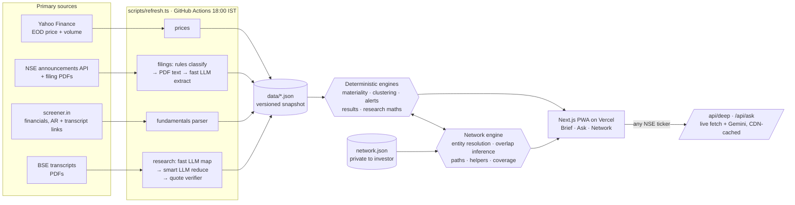

# FINN: what changed, why it matters, who to call

A mobile-first investment agent for an Indian-equities investor, built for the ENAM Founding AI Engineer build challenge.

- **Brief (Push).** Every NSE filing across an 18-stock portfolio, scored for materiality with visible reasons. Each event's filings are folded into one card, and routine paperwork is collapsed into a single line. End-of-day price and volume alerts use thresholds you set, and each move is matched to the filing that best explains it. When no filing explains a move, FINN says so.
- **Ask (Pull).** Research on any NSE ticker, grounded only in primary sources: snapshot, trajectory, balance sheet, cash quality, **promised vs delivered** from earnings-call transcripts, and bull vs bear.
- **Network.** The investor's own contacts, matched against filings and holdings. It shows who to call and why, routes to a newly appointed CEO, gaps in coverage against the book, reasons to reconnect, and a warning when a contact is a current insider.

The network is woven into Push and Pull rather than built as a separate app. Every card that has a network angle carries a "thread" line, for example: *"Meera Krishnan overlapped with Anup Bagchi."*

> **Data honesty.** The market data, filings, financials, transcripts and executive profiles are **real**, captured on 9 Nov 2026 from NSE, BSE, Yahoo Finance and screener.in. The investor's **contacts are synthetic**: realistic careers at real organisations, invented people. Links between a contact and a real executive are **inferred** from overlapping employers and years, and labelled as inferred. They are never asserted.

## Run it

```bash
npm install
npm run dev            # http://localhost:3000, best viewed at phone width
npm test               # engine sanity checks against the real snapshot
```

No API key is needed. The snapshot, deterministic engines and seeded analyses make the whole demo work offline.

Optional extras:

```bash
cp .env.example .env.local   # add GEMINI_API_KEY (free at aistudio.google.com/apikey)
npm run refresh              # re-pull prices, filings, fundamentals and research live
```

With a key, two more things become live:
- Promised vs delivered for **any** ticker (`/company/<SYMBOL>` → "Read the transcripts").
- LLM extraction of facts and people from new filing PDFs in the pipeline.

## Deploy

1. Push to GitHub and import the repo on Vercel. It deploys as a standard Next.js app with no configuration.
2. Optional: add `GEMINI_API_KEY` in the Vercel project's environment variables.
3. Optional: add the same key as a GitHub Actions secret. `.github/workflows/refresh.yml` then refreshes data every weekday at 18:00 IST and commits the snapshot, which triggers a Vercel redeploy.

## Architecture



**Where the models are, and are not, used**

| Step | Who does it | Why |
|---|---|---|
| Classify 190 filings into 18 categories | **Rules** (NSE descriptor + subject regexes). The fast model only sees the leftovers | 93% classify confidently by rules; instant, free and deterministic |
| Materiality score and tier | **Code**, with visible reasons | Judgment must be explainable and tunable |
| Results first cut (Revenue, EBITDA, PBT, PAT; QoQ and YoY) | **Code** over the reported numbers | Numbers must never be hallucinated |
| Facts and people from a filing PDF | **Gemini Flash-Lite**, only for material categories | Narrow extraction; cheap model; ~500 free requests a day |
| Forward-looking statements per transcript (map) | Pre-filtered by **code** (about 10× fewer tokens), then **Flash-Lite** | Bulk reading |
| Promised vs delivered, bull vs bear (reduce) | **Gemini Flash**, one call per company per quarter, cached at the CDN | The one step that needs reasoning across sources |
| Check every quote exists in the transcript | **Code** | Grounding enforcement; unverifiable quotes are dropped |
| Network matching, paths, who to call | **Code only** | Personal data never goes to a model |
| "Ask FINN" routing | **Rules** first, Flash-Lite plans the rest | Plans are small tool-call lists that code executes |

Model names are configurable (`FINN_MODEL_FAST`, `FINN_MODEL_SMART`), with automatic fallback across model generations.

## Repo map

```
app/            Next.js routes: / (Brief) · /event/[id] · /ask · /company/[symbol] · /network · /person/[id] · /api/*
components/     UI (no UI kit: hand-built for a phone)
lib/
  classify.ts   rules classifier + headline cleanup
  push.ts       materiality scoring, event clustering, move alerts, attribution
  research.ts   deterministic analysis: results card, trajectory, balance sheet, cash quality
  deep.ts       promised vs delivered (map → reduce → verify)
  network.ts    entity resolution, overlap inference, paths, helpers, coverage, nudges, insights
  ask.ts        intent planner (rules) → tool steps
  llm.ts        Gemini client: routing, fallbacks, caching
  sources/      screener.in parser (DOM-only, runs in Node via linkedom), PDF text
scripts/        refresh.ts (live pipeline) · import-seed.ts (raw captures → snapshot) · selftest.ts
data/           snapshot (real) + network.json (synthetic contacts, real executives from filings)
data/raw/       the raw captures exactly as pulled from the sources, kept for provenance
```

See [WRITEUP.md](WRITEUP.md) for decisions, trade-offs, privacy and what's next.
